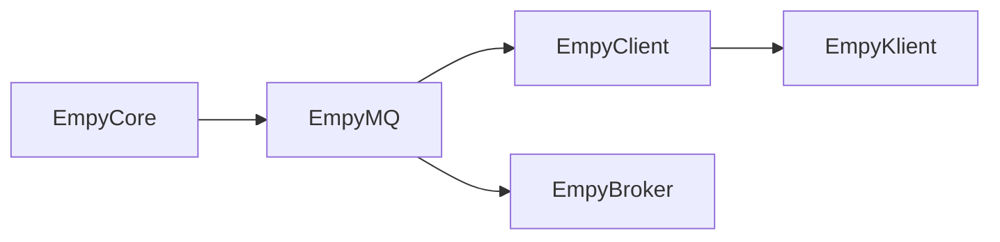

# Empy / MMQP

C++20 implementation of the MMQP IoT-Communication framework. The broker and client run over TCP, TLS 1.3 or optional MsQuic. Payload encryption uses **NIST Ascon-AEAD128**, with hierarchical HKDF-SHA256 topic keys. The implementation includes the nine packet codecs, session establishment and resumption, mutual HMAC authentication, profiles and aliases, shared subscriptions, QoS 0/1, retained publications, wills, keepalive and request/response. The broker also supports live MHF routing over mutual TLS/QUIC, quorum-backed session ownership and failover, durable broker state, tenant realms and bounded retained replay. Clients can automatically resume on another broker and persist their encryption nonce/replay state. Membership is explicitly configured; deployment assumptions and recovery procedures are in the clustering guide.

- [Feature-by-feature implementation plan](docs/IMPLEMENTATION_PLAN.md)
- [Project context and verified status](docs/PROJECT_CONTEXT.md)
- [Wire conventions and interoperability decisions](docs/PROTOCOL_DECISIONS.md)
- [Validation and future qualification](docs/VALIDATION.md)
- [Cluster configuration, persistence and failure model](docs/CLUSTERING.md)
- [Live web dashboard: setup, telemetry and metric definitions](docs/DASHBOARD.md)

## Project layout

| Directory | Target | Responsibility |
| --- | --- | --- |
| `EMPY_LIB_CORE` | `EmpyCore`, shared | Generic ECS, events, workers, configuration and module lifecycle |
| `EMPY_LIB_MQ` | `EmpyMQ`, shared | Wire protocol, transports, broker state, live fabric and durable storage |
| `EMPY_LIB_CLIENT` | `EmpyClient`, shared | Client session/API, payload encryption and key handling |
| `EMPY_IMPL_BROKER` | `EmpyBroker`, executable | Broker configuration and monitoring module |
| `EMPY_IMPL_CLIENT` | `EmpyKlient`, executable | Publish, subscribe, request and responder example |
| `EMPY_DASHBOARD` | Python web app | Read-only live topology, broker/client observations, sessions and traffic history |



The arrows indicate public dependencies: MQ links Core, and Client links MQ. Core has no protocol or networking dependency. Broker protocol code belongs in MQ so applications can embed it without depending on the broker executable.

## Build

Requirements: CMake 3.20+, a C++20 compiler with `<format>` support, standalone Asio, OpenSSL 3 and threads. Conan 2 can supply Asio and OpenSSL; EnTT, fkYAML, Rang and the task pool are already bundled. The pinned Ascon reference and its license are in `EMPY_LIB_CLIENT/src/Vendors/Ascon`.

With a configured Conan profile and build tools on `PATH`:

```bat
EmpyWin.bat Debug
EmpyWin.bat Release
```

```sh
bash EmpyLinux.sh Debug
```

The wrappers build all five targets and run CTest. They preserve user presets. Set `CMAKE_GENERATOR` to select another generator. Use separate build directories for different compilers, configurations or dependency toolchains. Alternatively, configure installed dependencies directly:

```sh
cmake -S . -B Targets/Build -DCMAKE_BUILD_TYPE=Debug \
    -DEMPY_ASIO_INCLUDE_DIR=/path/to/asio/include \
    -DOPENSSL_ROOT_DIR=/path/to/openssl -DEMPY_ENABLE_QUIC=OFF
cmake --build Targets/Build --parallel
ctest --test-dir Targets/Build --output-on-failure
```

For a multi-configuration generator, also pass `--config Debug` to the build and `-C Debug` to CTest. Outputs are under `<build-directory>/<configuration>`. Windows builds automatically stage project, OpenSSL, compiler and optional MsQuic runtime DLLs beside the executables, including transitive imports. A missing dependency fails the build. Use `EMPY_RUNTIME_DIRECTORIES` for additional DLL search directories; each executable has a SHA-256 `.runtime.txt` manifest. OpenSSL's enabled dynamic compression providers are included too: this local OpenSSL build needs `zlib1.dll`, which is absent from its normal PE import table `EMPY_RUNTIME_LIBRARIES` can add other explicitly runtime-loaded DLLs. Windows OS DLLs are supplied by Windows. Rebuilding also repairs deleted staged dependencies even when no executable relinks. See the project context for the exact commands verified on the author's machine.

QUIC is enabled by default in this checkout and requires MsQuic. Set
`EMPY_ENABLE_QUIC=OFF` for a TCP/TLS-only build; it never silently falls back to TCP:

```sh
cmake -S . -B Targets/Build -DEMPY_ENABLE_QUIC=ON \
    -DEMPY_MSQUIC_ROOT=/path/to/msquic
```

MsQuic must provide its public API v2 headers, import library and runtime. On Windows, `EMPY_MSQUIC_RUNTIME` can select a particular `msquic.dll`, which CMake copies next to the targets. The OpenSSL build accepts PEM credentials. A Schannel build requires `certificate_hash` referencing an existing credential in the Windows Current User certificate store. Empy does not install certificates or private keys in that store. The configuration and tests here use PEM files with Microsoft's [MsQuic OpenSSL package](https://www.nuget.org/packages/Microsoft.Native.Quic.MsQuic.OpenSSL).

For `EmpyWin.bat`, put the native MinGW `bin` directory on `PATH` before running
Conan. The wrapper checks for GCC, G++ and `mingw32-make`, then passes the compiler
paths to Conan so its MSYS tools cannot select a POSIX GCC instead. Set
`EMPY_MSQUIC_ROOT` and, for the PEM-based QUIC tests, `EMPY_MSQUIC_RUNTIME` in the
environment before the first configuration. These initialize the corresponding
CMake cache entries; existing builds use their cached values or explicit `-D`
overrides. The Windows wrapper writes binaries to `Targets/<configuration>/<configuration>`.
See the project context for the verified local paths and commands.

## Run the examples

These examples use the default loopback TCP listener on port 5600. From the output directory, run each command in its own terminal; append `.exe` on Windows.

```sh
./EmpyBroker --monitor
./EmpyKlient subscribe 'sensors/#' --qos 1
./EmpyKlient publish sensors/room/temperature '21.4' --qos 1
```

Request/response:

```sh
./EmpyKlient respond rpc/temperature '21.4'
./EmpyKlient request rpc/temperature '?' --seconds 10
```

`--seconds N` bounds the run; `--count N` bounds publications or received messages. `--verbose` reports when a subscriber/responder profile is ready. Ctrl+C shuts down the executable. `--help` lists available arguments. QoS 0 publication completion means local transport acceptance; QoS 1 completion means a broker PUBACK. Applications receive incoming messages through events.

The default listener accepts anonymous clients only on loopback. Use `--config <file>` with [Configs/Broker.yaml](Configs/Broker.yaml) or [Configs/Client.yaml](Configs/Client.yaml) to set resource limits. Relative paths in configuration files resolve against the configuration file's directory. All seconds encoded as TIE must be exactly representable; for example 30, 60, 300 and 3600 are valid, while 64 is not rounded silently.

For TLS or QUIC, start from the `BrokerTls` / `ClientTls` or `BrokerQuic` / `ClientQuic` YAML pairs in `Configs`. Supply PEM credentials and a matching CA file. Set `EMPY_AUTH_KEY` to the same separately provisioned hexadecimal key (at least 32 bytes) in broker and client environments. These templates enforce HMAC authentication over verified TLS. Add `mutual_tls: true` on the broker and client certificate/key paths on clients when client certificates are required.

For E2E payload protection, set `payload_key_env: EMPY_PAYLOAD_KEY` in each participating client's configuration and provision the corresponding root or subtree key there. **Do not put the payload key in broker configuration.** Authentication and payload keys must be different. A root grant contains 16 or 32 bytes; a delegated grant contains 16 bytes, `key_subtree`, and `key_epoch`. All intended recipients need the appropriate grant and accepted epoch range. Set `payload_state_directory` to a private directory unique to that client to preserve nonce reservations and replay windows across process restarts. Never clone or roll back that directory. The key itself remains externally provisioned.

For standalone broker recovery, use [BrokerDurable.yaml](Configs/BrokerDurable.yaml).
For three-node clustering, use [BrokerCluster.yaml](Configs/BrokerCluster.yaml)
and [ClientFailover.yaml](Configs/ClientFailover.yaml), following the
[cluster guide](docs/CLUSTERING.md). [BrokerTenants.yaml](Configs/BrokerTenants.yaml)
shows separate authentication realms and namespace restrictions.

## Monitor the network

The dark web dashboard shows actual cluster links, live traffic, client sessions,
queues, request/response state and broker availability. Enable telemetry on each
broker and run the collector from the repository root:

```sh
Targets/Build/Debug/EmpyBroker --config Configs/BrokerDashboard.yaml
python EMPY_DASHBOARD/app.py --config Configs/Dashboard.json
```

Open **http://127.0.0.1:8080**. The dashboard requires Python 3.10+ and no third-party
packages or frontend build step. For an isolated three-broker demo with real
publishers, subscribers and RPC clients:

```sh
python EMPY_DASHBOARD/demo.py --bin Targets/Build/Debug --openssl openssl
```

To test clustering at scale, deploy 10 to 256 local brokers with generated
certificates, drive them with the built-in load generator and get a throughput,
loss, latency and resource report. A comma list runs a sweep:

```sh
python EMPY_DASHBOARD/cluster.py --brokers 100 --bin Targets/BuildRelease/Release --openssl openssl
python EMPY_DASHBOARD/cluster.py --brokers 3,10,30,100 --no-dashboard --rate 2 --openssl openssl
```

Read the [dashboard guide](docs/DASHBOARD.md) for multi-broker configuration,
remote collection, telemetry tokens, metric definitions and testing commands.
The dashboard remains independent of the client application and never receives
payload contents or encryption credentials.

## Embed the client

Link `EmpyClient` and include `<eClient/API.h>`:

```cpp
eMQ::Client client;
client.On<eMQ::Receive>("sensors/#", [] (const eMQ::Receive& event)
{
  // event.message.topic is canonical; payload is plaintext when decrypted is true.
  std::cout << event.message.topic << '\n';
});
client.Connect("127.0.0.1", 5600);
auto subscription = client.Subscribe("sensors/#", 1).get();
if (subscription.code >= 0x80) 
  throw std::runtime_error(subscription.text);
client.StartService(10);
```

Call `Poll()` from an existing application loop instead of `StartService()` if the application owns its loop. Application callbacks, listener registration and module changes belong to that owner thread. Network protocol state runs on a separate serialized executor. Worker tasks can post back to the owner.

`Register`, `Subscribe`, `Unsubscribe`, `Publish`, `Request`, `Respond` and `UpdateProfile` return futures. Inspect `Reason::code`; codes below `0x80` are successful outcomes. `Disconnect()` retains resumable in-memory state; `Connect(host, port, true)` requests that SID again. `autoReconnect` and `failoverEndpoints` resume automatically after unexpected broker failure. `Stop()` permanently stops the instance. A new client process uses a fresh SID; broker recovery and optional cipher persistence do not serialize the client API.

Use `ClientOptions::cipher` with `PayloadCipher` for programmatic key provisioning. `PayloadCipher::Rotate` advances the accepted epoch range and wipes cached derived keys. `Client::On<Receive>` dispatches accepted plaintext once; authentication failures do not release candidate plaintext. A duplicate encrypted retained envelope is acknowledged without emitting the same plaintext event again.

For concurrent RPC, supply distinct request IDs and match `Receive::message.correlationId`:

```cpp
auto first = client.Request("rpc/temperature", {'A'}, 1, 1, 101);
auto second = client.Request("rpc/temperature", {'B'}, 1, 1, 102);
// These futures report publication acceptance. Responses arrive through Receive.
```

Register the request topic with `Register(topic, 0, 60, 1, true)` first. A responder
uses `Subscribe(topic, 1, true)` and replies with `Respond(event.message, payload)`,
which echoes the received ID and QoS. The explicit form is
`Respond(topic, correlationId, payload, reason, qos)`. A topic-only response is
ambiguous and is no longer accepted by the API. Omitting the final `Request` ID
selects an unused value automatically. Equal IDs in different requester sessions
are safe; the broker translates responder-facing IDs and restores the caller's ID.
At QoS 0 the request future reports local send admission; at QoS 1 it reports
the broker's PUBACK. Neither future waits for application responses.

## Semantics to preserve

- A QoS 0 subscription receives only QoS 0 publications. QoS 1 receives both.
- REG QoS selects retention: 0 is last value, 1 is bounded FIFO. Only QoS 1 publications are retained. `Register(topic, 1, expirySeconds, queueSize)` selects FIFO; the default selects last value.
- Wildcards use complete `+` levels or terminal `#`. Shared subscriptions use `$share/<group>/<filter>`. Ordinary root wildcards exclude reserved `$` topics.
- PRT REQ/RES alone selects the mandatory two-byte request ID (`correlationId`) at QoS 0/1, independently of the QoS packet ID. The former COR bit is reserved and must be zero. Requests on the same topic run concurrently; IDs are nonzero and never reused within a SID, and exhaustion requires a fresh session. No-responder and timeout results preserve the originating ID. Deploy matched peers; ordinary MSG encoding is unchanged. Persistent schema upgrade requirements are in [CLUSTERING.md](docs/CLUSTERING.md).
- Publication PIDs wrap after 65,535 using serial-number arithmetic, so a session continues indefinitely. Profile PIDs never wrap; establish a fresh session after 65,535 profile requests. Alias namespaces are also finite.
- A PUBACK confirms bounded protocol acceptance. Application callbacks and durable business transactions are separate. A durable broker checkpoint does not make an application's external side effects exactly once.
- The cipher uses a bounded 256-counter replay window per topic, epoch and random publisher prefix. A very late unseen envelope outside that window is rejected. Nonce/replay state persists only when its state directory is enabled.

The source preserves the existing Allman braces, four-space indentation, PascalCase methods/types, `m_` members and `EMPY_*` / `MMQP_*` naming. Read [AGENTS.md](AGENTS.md) and the context documents before extending it.
